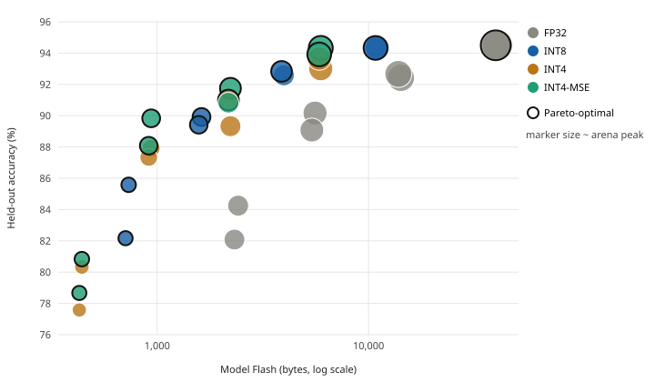

# tinyml-cmsis-quant-profiler

**Hardware-aware TinyML INT8/INT4 quantization compiler and bare-metal C inference profiler.**

Train a compact 1D-CNN, quantize it post-training to symmetric **INT8** or **packed INT4**, emit a
zero-dependency C header, and run it on a **zero-`malloc` ANSI C99 engine** on an emulated ARM
Cortex-M3, with *measured* SRAM arena peak, Flash footprint, MAC count and accuracy loss.



## Headline results

Measured on QEMU Cortex-M3 (`-Os`), synthetic 4-class sensor-anomaly task, 400 held-out windows.
Full table: [`reports/pareto_benchmark.md`](reports/pareto_benchmark.md).

| Model (c1-c2/k1) | Precision | Accuracy | Model Flash | Arena peak (SRAM) | MACs |
|---|---|---|---|---|---|
| 16-32/k5 | FP32 (analytic) | 92.67 % | 13,840 B | 3,712 B | 25,696 |
| 16-32/k5 | **INT8** | 92.83 % | **3,876 B** (3.6x smaller) | **928 B** (4x smaller) | 25,696 |
| 16-32/k5 | **INT4** | 91.00 % | **2,172 B** (6.4x smaller) | 928 B | 25,696 |
| 8-16/k3 | **INT4 + MSE clip** | 89.83 % | **936 B** | 488 B | 7,464 |

* INT8 PTQ is effectively lossless here (mean +0.19 pp vs FP32 across 8 architectures).
* INT4 costs ~2.4 pp with min-max scaling and ~1.4 pp with MSE-optimal clipping, for ~6x less Flash than FP32.
* Activation SRAM is 4x lower than FP32 purely from INT8 activations plus a ping-pong arena plan.
* The sweep checks, on target, that the smallest fitting arena budget runs clean and the next smaller one returns `TN_ERR_ARENA`.

Differences under ~1 pp are within seed noise (std is reported in the table). Data is synthetic: trends, not absolute accuracy, are the point.

## Pipeline

```
 compiler/dataset.py   synthetic sensor windows (normal / spike / burst / level-shift)
        |
 compiler/model.py     pure-NumPy 1D-CNN + Adam   (Conv1D-ReLU-Conv1D-ReLU-Dense)
        |
 compiler/quantizer.py PTQ: per-channel symmetric INT8 / INT4, calibrated INT8 activations,
        |              INT32 bias, Q31 requantisation; bit-exact integer reference
        +--> model_weights.h  (+ test_vectors.h)   zero-dependency C99 headers
                |
 runtime/tiny_nn.c     Conv1D, Dense, ReLU, ArgMax; static arena; no libc
        |
 bench/                host + Cortex-M3 (QEMU lm3s6965evb, semihosting) harness
        |
 compiler/profiler.py  reads arena peak / MACs from the target, Flash from the ELF
        |
 scripts/run_sweep.py  architecture x precision x arena-budget sweep -> reports/
```

### Quantization scheme

| Tensor | Scheme |
|---|---|
| Weights INT8 | symmetric, per-output-channel, range [-127, 127], zero-point 0 |
| Weights INT4 | symmetric, per-output-channel, range [-7, 7], packed 2/byte (low nibble first); optional MSE-optimal clip search |
| Activations | symmetric per-tensor INT8, zero-point 0, calibrated on 512 training windows |
| Bias | INT32 with scale `s_in * s_w[oc]` |
| Requantisation | `out = clamp((acc * mult[oc] + 2^(rs-1)) >> rs)`, Q31 `mult`, per-channel shift (TFLite / CMSIS-NN convention) |

Zero-points are exported for every tensor and honoured by the engine (they are 0 for the symmetric scheme).

### Runtime guarantees

* **No heap.** `runtime/tiny_nn.c` never calls `malloc/calloc/realloc/free`; the compiled Cortex-M object has
  no undefined symbols (no libc, not even `memcpy`). Both facts are tested.
* **Static arena.** One caller-provided buffer, double-ended bump allocator. Tensors ping-pong between the two ends, so a layer needs only `input + output` bytes; ReLU is in place. `tn_arena.peak` is the exact high-water mark, and `compiler/planner.py` predicts it byte-for-byte.
* **Bit-exact.** Host C, Cortex-M3 C and the Python integer reference produce identical int8 logits (checksum compared on target).
* **Strict C99.** Compiles with `-std=c99 -pedantic -Wall -Wextra -Werror -Wconversion`.

## Quick start

```bash
pip install -r requirements.txt          # numpy, scipy, pytest
sudo apt-get install gcc gcc-arm-none-eabi libnewlib-arm-none-eabi qemu-system-arm

pytest -q --tb=short                     # 45 tests: quantizer, runtime, QEMU, sweep

# train + quantize + export C headers
python3 -m compiler.quantizer --out build/model --bits 4 --clip mse

# run on host, then on an emulated Cortex-M3
make host MODEL_DIR=build/model
make qemu MODEL_DIR=build/model ARENA_SIZE=1024

# regenerate the sweep and report (~40 s)
python3 scripts/run_sweep.py
```

Example on-target output:

```
MODEL=tinycnn-w8a8-minmax   ARENA_SIZE=4096   SAMPLES=400
ARENA_PEAK=464   MACS=7472
ACC_INT=369   ACC_FP32=371   REF_MISMATCH=0   CHECKSUM_OK=1
```

### Using the engine in your firmware

```c
#include "tiny_nn_model.h"            /* includes generated model_weights.h */
static uint8_t arena[1024] __attribute__((aligned(8)));

tn_ctx ctx;
tn_arena_init(&ctx.arena, arena, sizeof arena);
uint32_t cls;
if (tn_run(&tn_model_desc, &ctx, sample_int8, &cls, NULL) == TN_OK) { /* cls, ctx.macs, ctx.arena.peak */ }
```

## Repository layout

| Path | Purpose |
|---|---|
| `compiler/` | dataset, NumPy trainer, PTQ + header export, arena/MAC planner, ELF/QEMU profiler |
| `runtime/` | `tiny_nn.{h,c}` engine and `tiny_nn_model.h` glue |
| `bench/` | harness, semihosting platform layer, Cortex-M3 startup + linker script |
| `scripts/run_sweep.py` | full sweep; writes `reports/` |
| `reports/` | `pareto_benchmark.md`, `pareto.svg`, raw `sweep_results.json` |
| `tests/` | pytest suite (runs QEMU if installed) |

## What is measured vs estimated

| Metric | How |
|---|---|
| Arena peak | recorded by the runtime allocator on target; cross-checked against the planner |
| MACs | counted by the runtime per inference; cross-checked against the analytic count |
| Flash `.model_rodata` | ELF section size (`arm-none-eabi-size -A`); weights, bias and requant parameters only |
| Engine code size | `size` on `tiny_nn.o`, `-Os`, Cortex-M3 |
| Accuracy loss | on target: INT engine vs FP32 predictions on the same held-out windows |
| FP32 rows | **analytic** (no FP32 kernel shipped): 4 B/param, 4 B activations |

## Limitations

* QEMU is functional, not cycle-accurate: **no latency numbers** are claimed. Cortex-M3 has no DSP/SIMD; a CMSIS-NN
  (`arm_dot_prod_q7`, M4/M7) backend would be the next step for speed. This project does not link CMSIS-NN.
* INT4 is weight-only storage (W4A8): weights are unpacked on the fly, which trades speed for Flash.
* PTQ only; no quantization-aware training. Static architecture (Conv1D, Conv1D, Dense); no padding, no pooling.
* Stack usage is not measured; Flash totals exclude startup code and the test vectors.
* Synthetic dataset; test set of 400 windows gives ~1.3 pp standard error.

## License

MIT
